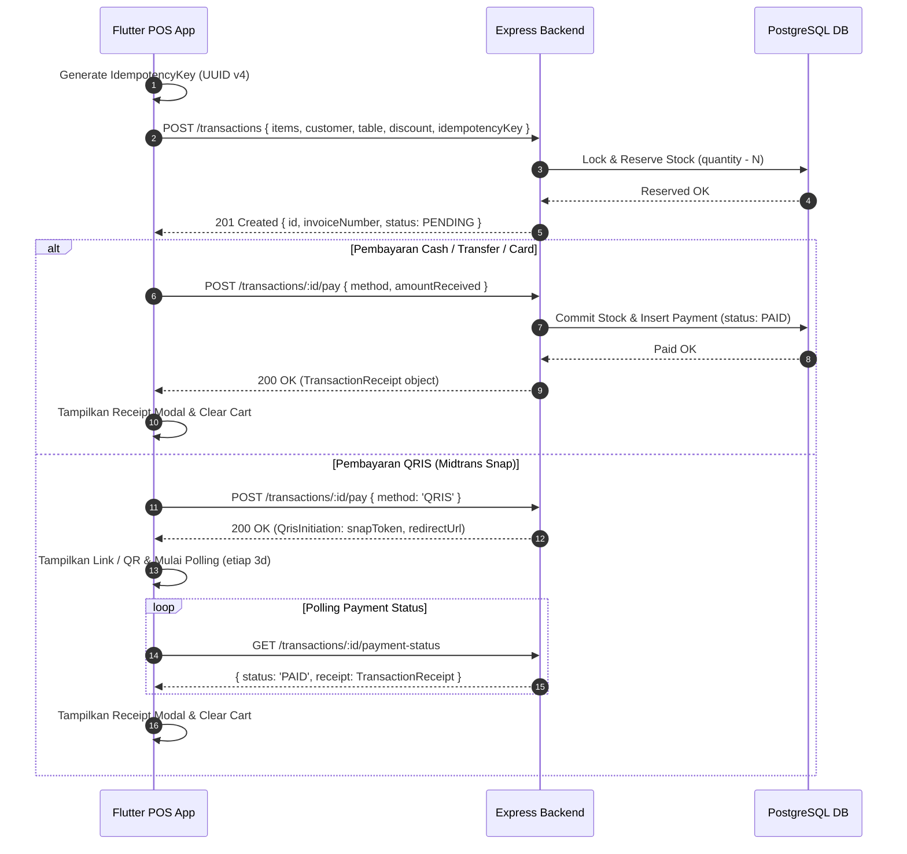

# Product Requirement Document (PRD) — Migrasi Frontend POS Kasir (YuaiPOS) ke Flutter

> **Dokumen Spesifikasi Produk & Migrasi Frontend**
> **Target Platform:** Flutter (Android Tablet/Mobile, iOS/iPadOS, Windows/Linux Desktop)
> **Backend Reference:** Exists in `@/backend` (`Express + TypeScript + PostgreSQL / Prisma / Drizzle`)

---

## 1. Pendahuluan & Latar Belakang

### 1.1 Visi Produk
**YuaiPOS (Cashy POS)** adalah aplikasi kasir Point of Sale (POS) modern yang dirancang untuk kecepatan operasional tinggi, efisiensi transaksi di meja kasir, dan kejelasan visual untuk industri F&B dan retail. 

### 1.2 Tujuan Migrasi
Migrasi frontend dari React + Vite + Tailwind CSS ke **Flutter** bertujuan untuk:
1. **Multi-Platform Native Performance:** Mendukung eksekusi aplikasi di Android Tablet (POS Terminal), iPadOS, serta Desktop (Windows & Linux POS hardware) dengan performa native 60–120 FPS tanpa tergantung browser.
2. **Hardware Direct Access:** Memudahkan integrasi langsung dengan perangkat POS seperti Printer Thermal (Bluetooth/USB/LAN ESC-POS), Cash Drawer (Laci Kasir), dan Customer Display.
3. **Consistent UI & UX:** Memastikan 100% kesamaan tampilan, tata letak (*layout*), skema warna, animasi, serta alur bisnis (*workflow*) dari aplikasi Web React sebelumnya.

### 1.3 Ruang Lingkup (Scope)
* **Frontend Flutter Only:** Seluruh antarmuka pengguna, manajemen *state*, pengolahan keranjang (*cart*), kalkulasi harga, validasi input, dan komunikasi API.
* **Backend Existing:** Mengonsumsi REST API dari repositori backend yang telah ada di `@/backend`. Tidak ada perubahan pada skema basis data backend.

---

## 2. Arsitektur Sistem & Integrasi Backend

### 2.1 Peta Endpoint REST API (Dikonsumsi oleh Flutter)

| Fitur / Layar | Method | Endpoint | Fungsi & Payload |
|---|---|---|---|
| Katalog Menu | `GET` | `/products?search={query}&categoryId={id}` | Memuat daftar produk, stok, harga, & threshold stok rendah. |
| Kategori Menu | `GET` | `/categories` | Memuat daftar kategori menu untuk filter. |
| Daftar Karyawan | `GET` | `/employees` | Memuat daftar kasir/karyawan untuk pilihan buka sesi shift. |
| Buka Sesi Shift | `POST` | `/shifts/open` | Body: `{ employeeId, pin, openingCash }`. Membuka sesi kasir & memverifikasi PIN. |
| Tutup Sesi Shift | `POST` | `/shifts/close` | Body: `{ employeeId, pin, countedCash? }`. Menutup sesi kasir, menghitung rekap & selisih kas. |
| Order Aktif | `GET` | `/orders` | Memuat daftar pesanan aktif dapur/fulfillment. |
| Update Order | `POST` | `/orders/:id/deliver` | Body: `{ fulfillment: 'COURIER' \| 'TABLE' }`. Tandai order telah diantar/diambil. |
| Buat Transaksi | `POST` | `/transactions` | Body: `{ items, customer, table, discount, idempotencyKey }`. Reserve stok & status `PENDING`. |
| Bayar Transaksi | `POST` | `/transactions/:id/pay` | Body: `{ method: 'CASH'\|'QRIS'\|'TRANSFER'\|'CARD', amountReceived }`. Set `PAID` atau return QRIS Snap. |
| Status QRIS | `GET` | `/transactions/:id/payment-status` | Polling status pembayaran QRIS Midtrans (`PENDING` -> `PAID`). |
| Riwayat Transaksi | `GET` | `/transactions?status=all` | Memuat daftar riwayat transaksi historis (`PAID`, `VOIDED`, `REFUNDED`). |

### 2.2 Alur Transaksi & Idempotency Key
SETIAP alur checkout pada Flutter Wajib mengikuti lifecycle transaksi backend:



### 2.3 Prinsip Utama Integrasi API
1. **Server as Single Source of Truth:** Kalkulasi subtotal, tax (10%), diskon, dan total akhir dihitung ulang oleh server saat `POST /transactions`. UI Flutter hanya melakukan kalkulasi preview lokal.
2. **Idempotency Key:** `idempotencyKey` dibuat di tingkat UI sebelum `POST /transactions` dipanggil. Jika koneksi terputus dan user menekan tombol bayar lagi, key yang sama dikirimkan untuk mencegah duplikasi pesanan.
3. **Error Envelope Standard:**
   ```json
   {
     "success": false,
     "error": {
       "code": "INSUFFICIENT_STOCK",
       "message": "Stok tidak mencukupi untuk produk Kopi Susu."
     }
   }
   ```
   Aplikasi Flutter wajib membedah `error.code` dan menampilkan pesan yang ramah pengguna dalam *snack bar* atau *dialog*.

---

## 3. Spesifikasi Fitur Lengkap (Functional Requirements)

### Fitur 1: Header & Navigasi Utama (Top Navigation)
* **Visual & Layout:** Height fixed 72dp, warna background `surface` (`#FFFFFF`), border bawah `outlineVariant` (`#C3CEC2`).
* **Komponen Left:**
  * Logo Icon POS (`point_of_sale`) dalam rounded container hijau primary (`#84C163`).
  * Judul Aplikasi: `YuaiPOS` (Font: *Plus Jakarta Sans*, Bold, 20sp, Warna: `primaryStrong` `#3F6B1C`).
  * Chip Outlet: Badge rounded full `Outlet Utama · Makassar`.
  * Badge Modal Awal: Chip warna `primaryContainer` (`#D8ECC5`) dengan icon `account_balance_wallet` & format rupiah modal awal (hanya tampil jika sesi kasir aktif & `openingCash > 0`).
* **Komponen Center (Navigation Links):**
  * **Home** (icon: `home`) — Tab POS Kasir.
  * **Order List** (icon: `list_alt`) — Tab Daftar Order Dapur.
  * **History** (icon: `history`) — Tab Riwayat Transaksi.
  * **Setting** (icon: `settings`) — Disabled / Fitur akan datang.
* **Komponen Right:**
  * Nama Kasir Aktif & Jam Realtime (Update per detik dalam format HH:mm:ss WITA/Local).
  * Tombol **"Tutup Sesi"** (Border outline, hover error container, icon `logout`). Hanya tampil jika sesi kasir aktif.
  * Avatar Profile Circle.

---

### Fitur 2: Manajemen Sesi Shift Kasir (Open & Close Shift)

#### A. Modal Buka Sesi (Open Shift Modal)
* **Trigger:** Tampil secara otomatis dan memblokir layar (*blocking overlay*) jika belum ada sesi kasir yang aktif (`session == null`).
* **Input Fields:**
  1. **Nama Karyawan:** Dropdown selector berisi list karyawan dari `GET /employees`.
  2. **PIN Karyawan:** Input password masked 4–6 digit numerik.
  3. **Modal Awal (Rp):** Input numerik uang tunai di laci saat toko buka.
* **Validasi & Aksi:**
  * Tombol "Buka Sesi" aktif jika Karyawan dipilih dan PIN >= 4 digit.
  * Panggil `POST /shifts/open`. Jika PIN salah (`INVALID_PIN`), tampilkan pesan error merah.
  * Jika sukses, simpan `ActiveSession` ke state aplikasi dan buka akses layar POS.

#### B. Modal Tutup Sesi (Close Shift Modal)
* **Trigger:** Klik tombol "Tutup Sesi" di Top Navigation Header.
* **Input Fields:**
  1. **PIN Karyawan:** Input password masked 4–6 digit numerik untuk konfirmasi penutupan.
  2. **Hitung Kas Fisik (Rp) [Opsional]:** Input jumlah uang tunai fisik yang dihitung di laci kasir.
* **Rekap Sesi (Shift Summary Report View):**
  * Tampil setelah `POST /shifts/close` berhasil dieksekusi:
    * Total Jumlah Transaksi Lunas (`transactionCount`).
    * Total Omset Penjualan Gross (`grossSales`).
    * Modal Awal Kasir (`openingCash`).
    * Total Penjualan Tunai (`cashSales`).
    * **Kas Seharusnya di Laci** (`expectedCash = openingCash + cashSales`).
    * Kas Di-hitung Fisik (`countedCash`).
    * **Selisih Kas** (`difference = countedCash - expectedCash`), berwarna hijau jika `0`, merah jika minus.

---

### Fitur 3: Grid Katalog Menu & Pencarian (Menu Grid)

* **Area Visual:** Flex 7 dari total lebar layar (Left Section).
* **Header & Search Bar:**
  * Judul "List Menu".
  * Input Search `Search menu...` dengan icon pencarian di sebelah kiri. Filter produk secara realtime berdasarkan nama.
* **Kategori Pills (Horizontal Scrollable):**
  * Pill "All Menu" (default active) diikuti kategori dari `GET /categories`.
  * Pill aktif berlatar belakang `primary` (`#84C163`) dengan teks putih `onPrimary` (`#FFFFFF`). Pill inaktif transparan dengan teks `onSurfaceVariant` (`#46524A`).
* **Card Produk (Product Card):**
  * **Aspek Rasio Gambar:** 1:1 (Square image), `BoxFit.cover` dengan rounded corners 8dp.
  * **Low Stock Warning:** Jika `stock <= lowStockThreshold`, tampilkan pill kuning warning di pojok kiri atas gambar (`Stok N`).
  * **Informasi Produk:** Judul Nama Produk (Bold), Kategori, dan Harga (Format Rp, Font *Plus Jakarta Sans* Bold).
  * **Tombol Aksi Tambah / Qty Control:**
    * Jika `qty == 0`: Tombol penuh `+ Tambah` berwarna `primary`.
    * Jika `qty > 0`: Controls trio `[-]`, `[ Qty ]`, `[+]`.
    * Jika `qty >= stock`: Tombol `[+]` di-disable dengan opacity 40% dan tooltip "Stok tidak mencukupi".

---

### Fitur 4: Sidebar Keranjang & Detil Pesanan (Order Sidebar)

* **Area Visual:** Fixed width (360dp di Desktop, 420dp di Wide Desktop), Flex-none Right Section, border kiri `outlineVariant`.
* **Header Keranjang:**
  * Judul "Order Detail", Badge Total Item Count (`N Items`), dan tombol "Clear All" (merah, menghapus seluruh isi keranjang).
* **Customer Info Bar:**
  * Menampilkan Nama Pelanggan (default: `Walk-in Customer`) dan Nomor Meja / Order Type (default: `Table 05`).
  * Tombol icon swap `swap_horiz` untuk mengedit Nama Pelanggan & Meja secara inline.
* **Daftar Item Keranjang (Scrollable List):**
  * Thumbnail Gambar Produk (48x48dp rounded).
  * Nama Produk, Harga Satuan x Qty.
  * Line Total Harga (Subtotal item).
  * Hover/Active Remove Icon `close` (menghapus item dari keranjang).
  * Empty State: Ilustrasi keranjang kosong + teks "Keranjang masih kosong".
* **Order Note Button / Field:**
  * Tombol dash border "Add Order Note" atau input text inline jika ditekan.
* **Promo Code & Rincian Biaya (Summary Section):**
  * Field Kode Promo + Tombol "Apply". (Kode promo `TERATUR10` memberikan diskon 10%).
  * Rincian Line Items:
    * `Subtotal` (Rp)
    * `Tax (10%)` (Rp)
    * `Discount` (-Rp, berwarna merah jika > 0)
    * `Total Amount` (Font 24sp *Plus Jakarta Sans* Bold, warna `primaryStrong`).
* **Tombol Utama "Payment Process":**
  * Height 56dp, rounded 12dp, warna `primary` dengan font bold 18sp. Disabled jika keranjang kosong atau sedang dalam proses (*busy spinner*).

---

### Fitur 5: Modul Pembayaran Multi-Metode (Payment Modal)

* **Header Modal:** "Pembayaran" + Badge Item Count + Tombol Close.
* **Ringkasan Tagihan Card:** Subtotal, Tax 10%, Diskon, dan Total Pembayaran.
* **Pemilihan Metode Bayar (Grid 4 Kolom):**
  * `CASH` (icon: `payments`)
  * `QRIS` (icon: `qr_code_2`)
  * `TRANSFER` (icon: `currency_exchange`)
  * `CARD` (icon: `credit_card`)
* **Alur Pembayaran Tunai (CASH Mode):**
  * Display Box "Uang Diterima" (Font 36sp Bold).
  * Display Box "Kembalian" (`Math.max(0, amount - total)`), berwarna hijau jika `amount >= total`, atau merah jika kurang.
  * **Keypad Numerik 3x4:** Tombol `1`–`9`, `C` (Clear), `0`, `00`.
  * Tombol **"Uang Pas"** (Mengisi `amount` persis sebesar `total`).
* **Alur Pembayaran Non-Tunai (QRIS / Transfer / Card):**
  * Menampilkan pesan "Pay via {METHOD} — Rp X.XXX.XXX".
  * Jika QRIS: Panggil API `payTransaction`, dapatkan Snap `redirectUrl`, tampilkan link dan indikator status polling.
* **Tombol Konfirmasi Pembayaran:**
  * Height 56dp, "Konfirmasi Pembayaran" dengan icon `verified`. Disabled pada mode CASH jika `amount < total`.

---

### Fitur 6: Struk Pembayaran & Simulator Cetak (Receipt Modal & Printer)

* **Struk Visual Design (Paper Look):**
  * Header Toko: Icon Checkmark Hijau, Judul "Struk Pembayaran", Invoice Number (`INV-YYYYMMDD-XXXX`), Timestamp, Metode Bayar, Nama Pelanggan.
  * Daftar Item: Nama Item x Qty, Harga Satuan, Total Line.
  * Rincian: Subtotal, Tax 10%, Diskon, Total Akhir.
  * Rincian Tunai: Uang Diterima & Kembalian.
* **Printer Emulation Animation:**
  * Mode "Cetak Struk" memicu animasi `AnimatedContainer` di mana kertas struk meluncur keluar secara bertahap dari slot printer (`duration: 2-3s`).
  * Indikator LED Printer (Kuning Kedip: *Printing*, Hijau: *Done*).
  * Tombol "Cetak Lagi" dan "Selesai / Transaksi Baru".
* **Integrasi Perangkat Printer Fisik (Flutter Native Spec):**
  * Menggunakan package `blue_thermal_printer` / `flutter_pos_printer_platform` / `printing` untuk mengirim ESC-POS command ke printer thermal 58mm / 80mm via Bluetooth / USB / LAN.

---

### Fitur 7: Dapur / Fulfillment Order List (Order List Page)

* **Tujuan Layar:** Memantau pesanan yang sedang diproses dapur atau siap disajikan.
* **Filter Tabs:** `Semua`, `Sedang Diproses`, `Telah Diantar`.
* **Card Order Aktif:**
  * Nomor Invoice & **Status Chip**:
    * `PENDING` (Abu-abu: Menunggu)
    * `COOKING` (Kuning/Orange: Masak)
    * `READY` (Hijau: Siap Saji)
    * `DELIVERED` (Biru Info: Telah Diantar)
  * Jumlah Item & Nomor Meja.
  * Timestamp Pemesanan.
  * **Tombol Aksi Delivery (Fulfillment):**
    * Tombol **"Ojek Online"** (`COURIER`)
    * Tombol **"Ke Meja"** (`TABLE`)
    * Mengubah status order menjadi `DELIVERED` via `POST /orders/:id/deliver`.

---

### Fitur 8: Riwayat Transaksi Historis (History Page)

* **Filter Tabs:** `Semua`, `Lunas` (`PAID`), `Dibatalkan` (`VOIDED`), `Refund` (`REFUNDED`).
* **Item List Row:**
  * Icon Metode Bayar (`CASH`, `QRIS`, `TRANSFER`, `CARD`).
  * Nomor Invoice, Waktu Transaksi, Total Item.
  * Total Uang Transaksi (Dicoret jika `VOIDED`/`REFUNDED`).
  * Status Badge (`Lunas`, `Dibatalkan`, `Refund`).
  * Klik item baris membuka **ReceiptModal** mode *View Only* (Close label: "Tutup").

---

## 4. Arsitektur Kode Flutter & Teknologi

### 4.1 Stack Teknologi Frontend Flutter
* **SDK:** Flutter 3.19+ (Dart 3.3+)
* **State Management:** `flutter_bloc` (BLoC Pattern untuk pemisahan logika bisnis & UI yang ketat).
* **HTTP & API Client:** `dio` dengan interceptor untuk logging, error handling, dan injection header token/idempotency.
* **Local Storage / Secure Credentials:** `flutter_secure_storage` (untuk PIN/Session) & `shared_preferences` (pengaturan lokal).
* **Fonts & Typography:** `google_fonts` (*Inter* & *Plus Jakarta Sans*).
* **Formatters:** `intl` (NumberFormat rupiah `id_ID` & DateFormat time).
* **Image Caching:** `cached_network_image` untuk optimasi memori katalog produk.
* **Hardware Printing:** `blue_thermal_printer` & `pdf` / `printing`.

### 4.2 Struktur Direktori Proyek Flutter (`lib/`)

```text
lib/
├── main.dart                   # Entry point, initialization, & theme root
├── core/
│   ├── constants/
│   │   ├── app_colors.dart     # Design System Color Tokens (0xFF...)
│   │   ├── app_typography.dart # GoogleFonts TextStyles
│   │   └── app_theme.dart      # ThemeData configuration
│   ├── network/
│   │   ├── api_client.dart     # Dio client configuration & interceptors
│   │   └── api_exceptions.dart # Mapping ApiError envelope
│   └── utils/
│       ├── currency_formatter.dart # Format Rupiah (Rp15.000)
│       └── date_formatter.dart     # Format Time & Clock
├── data/
│   ├── models/
│   │   ├── product_model.dart
│   │   ├── category_model.dart
│   │   ├── cart_item_model.dart
│   │   ├── active_order_model.dart
│   │   ├── receipt_model.dart
│   │   └── shift_model.dart
│   └── repositories/
│       ├── pos_repository.dart
│       └── shift_repository.dart
├── logic/                      # BLoCs / Cubits
│   ├── shift/
│   │   └── shift_cubit.dart
│   ├── catalog/
│   │   └── catalog_cubit.dart
│   ├── cart/
│   │   └── cart_cubit.dart
│   ├── checkout/
│   │   └── checkout_cubit.dart
│   ├── orders/
│   │   └── active_orders_cubit.dart
│   └── history/
│       └── history_cubit.dart
└── presentation/
    ├── navigation/
    │   └── top_nav_bar.dart
    ├── screens/
    │   ├── main_layout_screen.dart
    │   ├── pos_screen.dart
    │   ├── order_list_screen.dart
    │   └── history_screen.dart
    ├── widgets/
    │   ├── menu_grid_widget.dart
    │   ├── product_card_widget.dart
    │   ├── order_sidebar_widget.dart
    │   └── status_chip_widget.dart
    └── dialogs/
        ├── open_shift_modal.dart
        ├── close_shift_modal.dart
        ├── payment_modal.dart
        └── receipt_modal.dart
```

---

## 5. Matrix Persyaratan Non-Fungsional (NFR)

1. **Kecepatan & Responsivitas Touch Target:**
   * Seluruh tombol interaktif (Button, Keypad, Qty Control) wajib memiliki tinggi/lebar minimal **48dp x 48dp** agar mudah ditekan jari staf tanpa salah ketik saat jam sibuk.
2. **Kinerja Frame & Rendering:**
   * Animasi scrolling katalog menu & cetak struk wajib berjalan stabil pada 60 FPS.
3. **Resiliensi Jaringan & Penanganan Koneksi Putus:**
   * Jika panggilan API gagal akibat koneksi internet terputus, Flutter wajib menampilkan *snack bar* / dialog `NETWORK` dengan tombol "Coba Lagi" tanpa mereset isi keranjang kasir.
4. **Idempotensi & Keamanan:**
   * Token autentikasi dan PIN sesi kasir disimpan di secure storage. `idempotencyKey` wajib disertakan pada setiap transaksi baru.
